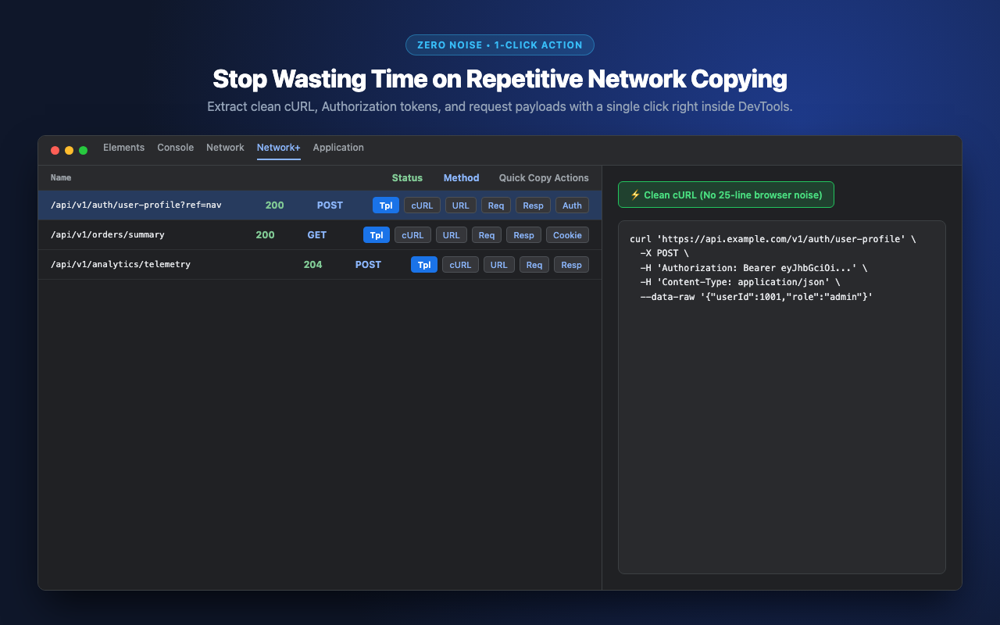
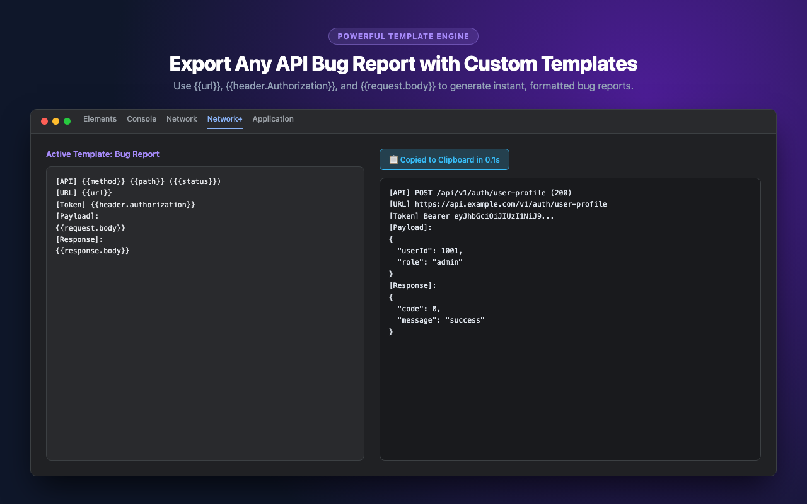
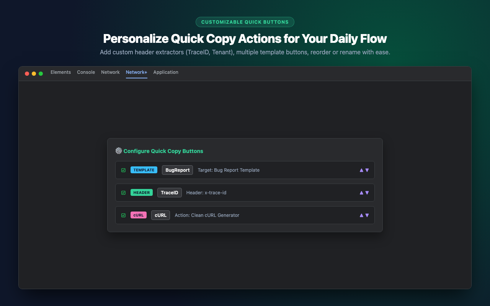

<div align="center">

# ⚡️ Network+ 

### Fast Network Inspection, Clean cURL & Custom Template Exporter for Chrome DevTools

[](https://developer.chrome.com/docs/extensions/mv3/intro/)
[](https://github.com/happybang/network_plugin_plus/actions)
[](https://opensource.org/licenses/MIT)
[](https://github.com/happybang/network_plugin_plus/pulls)
[](#-internationalization-i18n)
[](#)

<p align="center">
  <b>Stop painful copy-pasting: One-click Clean cURL, instant Token extraction, customizable row actions, and magic template exporting.</b>
  <br />
  Zero learning curve • Native DevTools look & feel • 100% offline & local
  <br /><br />
  <b>English</b> • <a href="README_zh.md">简体中文</a>
</p>

[The Daily Pain](#-the-daily-pain-why-network) • [Visual Walkthrough](#-visual-walkthrough) • [Key Features](#-key-features) • [Template Syntax](#-custom-template-engine) • [Installation](#-quick-start) • [Publishing Guide](docs/STORE_PUBLISHING_GUIDE.md)

---

</div>

## 😩 The Daily Pain: Why Native DevTools Slows You Down

**Picture this:** It's 4:30 PM. Your backend teammate drops a message in Slack:  
> *"Hey, that checkout API returned a 500 error, can you send me the request?"*

You open Chrome DevTools:
1. Right-click the request row.
2. Hover over `Copy` ➔ select `Copy as cURL (bash)`.
3. Paste it into Slack... and suddenly, a **45-line wall of junk** fills the chat!  
   `sec-ch-ua: "Not_A Brand";v="8"`, `sec-fetch-dest: empty`, `priority: u=1, i`, and 20 tracking cookies nobody asked for.  
   Your teammate sighs: *"Bro, which header is the token? And where is the body?"*

Or worse: You just need the `Authorization: Bearer eyJhbG...` token to test an endpoint in Postman. You click the request, switch to Headers, scroll past 30 headers, carefully highlight the token without accidentally selecting trailing spaces, and copy it. You do this **30 times a day**. That's 150 clicks and 15 minutes of wasted cognitive energy every single day.

| Scenario | Native Chrome DevTools Frustrations | ⚡️ Network+ Solution |
| :--- | :--- | :--- |
| **Copy cURL** | Copies 25+ lines of browser noise (`sec-ch-ua*`, `sec-fetch-*`), cluttering terminals and tickets | **One-click Clean cURL**: Automatically strips noise headers, keeping commands crisp and clean |
| **Copy Token / Header** | Click request ➔ switch to Headers ➔ scroll & find ➔ carefully highlight | **Direct extraction**: One-click to copy `Authorization` or `Cookie` |
| **Copy Request Body** | Click request ➔ switch to Payload ➔ `view source` ➔ select all ➔ copy | **Instant `[Req]` pill button** directly on the row |
| **Report API Bug to Team** | Manually copy URL, request body, response, and token, then stitch and format in Slack/Jira | **One-click `[Tpl]`**: Formats all data automatically using your customized template |
| **Row Actions Customization**| Fixed context menu, zero configuration | **⚙️ Quick Button Config**: Reorder, rename, or add custom header & template buttons |

---

## 📸 Visual Walkthrough

<div align="center">
  
  <p><i>1. Clean cURL generation and zero-click inline action pills on every row</i></p>

  
  <p><i>2. Magic Template Engine with live preview and placeholder replacement</i></p>

  
  <p><i>3. Personalize row quick buttons: reorder, rename, and add custom header extractors</i></p>
</div>

---

## ✨ Key Features

### 1. ⚡️ Clean cURL (Zero Noise)
Standard `Copy as cURL` clutters terminal history with browser telemetry headers.
- Network+ intelligently strips `sec-ch-ua*`, `sec-fetch-*`, `accept-language`, `priority`, and other noise;
- Retains only essential headers (`Authorization`, `Content-Type`, `Cookie`), ready to run in terminal or import into Postman.

### 2. 🎯 Zero-Click Submenu: Inline Action Pills
Every row in your network table gets dedicated, instant action pills:
```text
[Tpl]  [cURL]  [URL]  [Req]  [Resp]  [Cookie]
```
No nested menus, no tab switching — click once and it's on your clipboard.

### 3. 🧩 Custom Template Engine (Game Changer)
Compose your own export formats using simple placeholders like `{{url}}`, `{{header.Authorization}}`, `{{request.body}}`, and `{{response.body}}`.
- **Top Toolbar「Templates」**: Add, edit, rename, and manage custom templates anytime;
- **Live Preview**: See real-time formatted output using actual inspected requests as you type;
- **Row-level Primary Action**: The **`[Tpl]`** button is placed first in the row action group for instant 1-click exporting!

### 4. ⚙️ Fully Customizable Quick Buttons
Every engineering team has different habits. Click **⚙️** in the table header to open the Quick Button Manager:
- **Reorder & Rename**: Move your most-used buttons to the front.
- **Custom Header Buttons**: Add a 1-click button for `x-trace-id`, `x-request-id`, or `tenant-id`.
- **Multiple Template Buttons**: Bind specific buttons to specific templates (e.g. `[BugReport]`, `[PostmanJSON]`).
- **Show/Hide**: Keep your table clean and minimal.

### 5. 🌐 Internationalization (i18n)
Full native Chrome Extension i18n supporting **10 languages**:
- English (`en`), 简体中文 (`zh_CN`), 繁體中文 (`zh_TW`), 日本語 (`ja`), 한국어 (`ko`), Español (`es`), Français (`fr`), Deutsch (`de`), Русский (`ru`), Português (`pt_BR`).

### 6. 🎨 100% Native DevTools Experience
- Matches Chrome DevTools design aesthetics seamlessly;
- Automatically syncs with **Dark / Light theme** based on your DevTools settings;
- Real-time search filter, resource type pills (All / Fetch / JS / CSS / Img / Doc), and split-view details drawer.

---

## 📖 Custom Template Engine: Syntax & Presets

### Available Placeholders

| Placeholder | Description | Example Output |
| :--- | :--- | :--- |
| `{{url}}` | Full Request URL | `https://api.example.com/v1/user?id=1001` |
| `{{path}}` | URL Pathname | `/v1/user` |
| `{{method}}` | HTTP Method | `POST` / `GET` |
| `{{status}}` | HTTP Status Code | `200` |
| `{{time}}` | Duration | `48 ms` |
| `{{size}}` | Transferred Size | `1.4 kB` |
| `{{header.HeaderName}}` | **Extract any Request Header** | `{{header.Authorization}}`, `{{header.x-request-id}}` |
| `{{resp.header.HeaderName}}`| **Extract any Response Header** | `{{resp.header.Content-Type}}` |
| `{{request.body}}` | Formatted Request Body (JSON/Text) | `{\n  "role": "admin"\n}` |
| `{{response.body}}` | Formatted Response Body (JSON/Text)| `{\n  "code": 0\n}` |
| `{{curl}}` | Clean cURL Command | `curl '...' -H '...'` |
| `{{curl.full}}` | Full cURL Command | Including all browser headers |

---

### 💡 Built-in Presets

#### Preset A: Bug Report (Default)
```text
[API] {{method}} {{path}} ({{status}})
[URL] {{url}}
[Token] {{header.authorization}}
[Request]:
{{request.body}}
[Response]:
{{response.body}}
```

#### Preset B: Markdown API Documentation
````markdown
### API: `{{method}} {{path}}`
- **URL**: `{{url}}`
- **Status**: `{{status}}`
- **Token**: `{{header.authorization}}`

```json
// Request
{{request.body}}
```

```json
// Response
{{response.body}}
```
````

---

## 🚀 Quick Start

Zero build steps required. Pure Vanilla JS running directly in Chrome:

1. **Clone this repository**:
   ```bash
   git clone https://github.com/happybang/network_plugin_plus.git
   ```

2. **Load Unpacked Extension in Chrome**:
   - Open Chrome and navigate to `chrome://extensions/`
   - Enable **Developer mode** (toggle in the top-right corner)
   - Click **Load unpacked** (top-left button)
   - Select the `network_plugin_plus` folder

3. **Start Using**:
   - Press `F12` (or right-click ➔ `Inspect`) to open DevTools
   - Click the **`Network+`** tab in the top navigation
   - Trigger any network request, then click **`[Tpl]`** or any quick button to copy!

---

## 📦 Chrome Web Store Publishing

Interested in publishing your own customized build or distributing to your team?
- Read our step-by-step [Chrome Web Store Publishing Guide](docs/STORE_PUBLISHING_GUIDE.md).
- Use ready-to-use marketing descriptions in [Store Listing Description](docs/STORE_LISTING_DESCRIPTION.md).
- Generate store submission ZIP:
  ```bash
  npm run build:zip
  ```

---

## 🔒 Security & Privacy

- **100% Local Execution**: Built strictly on Chrome Manifest V3 and official DevTools Network APIs;
- **Zero Network Outbound**: No telemetry, no tracking, and no external analytics. Your requests and tokens never leave your machine;
- **Zero Third-party Dependencies**: Completely auditable, transparent Vanilla JS.

---

## 🧪 Testing

The core utility logic (cURL generation, noise header removal, template rendering engine, quick button resolution) is covered by comprehensive unit tests:

```bash
npm test
# Or run directly with Node built-in test runner:
node --test tests/utils.test.js
```

---

## 🤝 Contributing

Contributions, bug reports, and suggestions are warmly welcomed!
- Feel free to open an [Issue](https://github.com/happybang/network_plugin_plus/issues)
- Submit a [Pull Request](https://github.com/happybang/network_plugin_plus/pulls)

**If Network+ saves you time, please give it a ⭐️ on GitHub!**

---

<div align="center">
  <sub>Made with ❤️ for developers by developers. Released under the MIT License.</sub>
</div>
