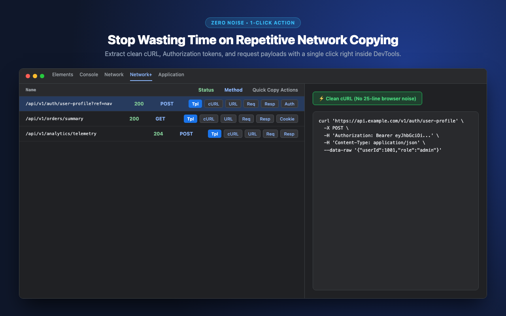
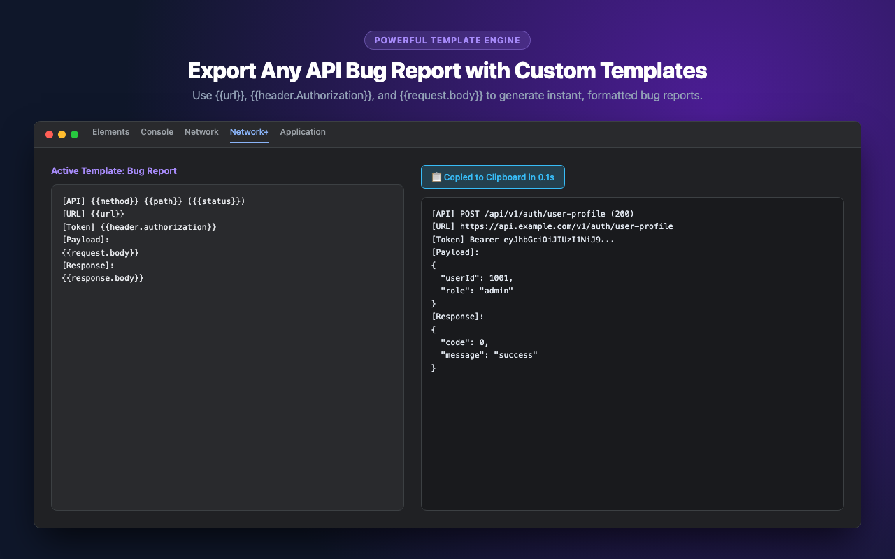
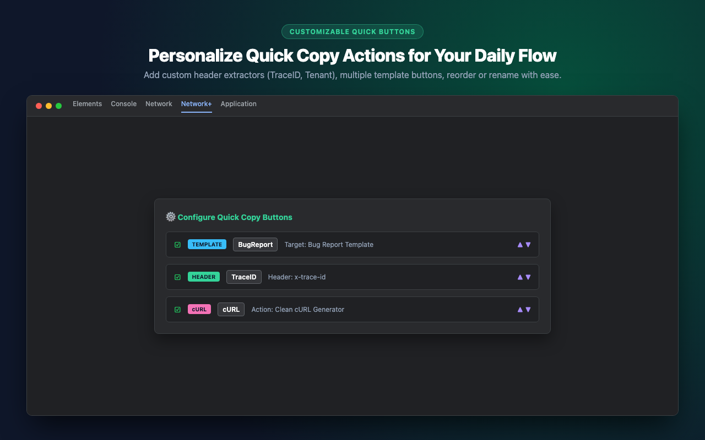

<div align="center">

# ⚡️ Network+ 

### 专为开发者打造的 Chrome DevTools 极速网络复制与模版导出神器

[](https://developer.chrome.com/docs/extensions/mv3/intro/)
[](https://github.com/happybang/network_plugin_plus/actions)
[](https://opensource.org/licenses/MIT)
[](https://github.com/happybang/network_plugin_plus/pulls)
[](#-原生-10-国语言国际化)
[](#)

<p align="center">
  <b>让接口复制不再痛苦：一键复制纯净 cURL、提取 Token、自定义行快捷按钮、按模版秒级导出 Bug 报告。</b>
  <br />
  零学习成本 · 高仿 Chrome 原生体验 · 完全本地离线运行
  <br /><br />
  <a href="README.md">English</a> • <b>简体中文</b>
</p>

[痛点场景](#-身临其境研发每天经历的低效折磨) • [界面实景](#-视觉实景) • [核心特性](#-核心特性) • [模版语法](#-自由定制模版语法) • [快速安装](#-快速上手) • [商店上架指南](docs/STORE_PUBLISHING_GUIDE.md)

---

</div>

## 😩 身临其境：研发每天经历的低效折磨

**想象这样一个日常场景：**  
下午 4:30，后端同事在群里发来一条消息：  
> *“刚才那个下单接口报了 500，把完整的请求发我看看。”*

你熟练地打开 Chrome DevTools：
1. 在 Network 面板找到那行请求，右键。
2. 鼠标小心翼翼移到 `Copy` ➔ 点击 `Copy as cURL (bash)`。
3. 粘贴到聊天窗口……瞬间弹出 **45 行冗余垃圾**！  
   `sec-ch-ua: "Not_A Brand";v="8"`, `sec-fetch-dest: empty`, `priority: u=1, i`，还有一堆和业务无关的追踪 Cookie。  
   后端叹气：*“兄弟，哪个才是真正的 Header？Body 在哪儿？”*

还有更折磨的：你只是想取一下 `Authorization: Bearer eyJhbG...` 的 Token 去 Postman 跑一下测试。  
你得先点进请求，切换到 Headers 标签，在一大串 Header 里翻滚寻找，小心翼翼用光标选准 Token 字符，千万别带多空格，复制，再切回 Postman。  
**这样的操作，每个研发每天要重复 30 到 50 次。每天平白无故浪费十多分钟，全被消磨在这种无意义的机械点击中！**

| 场景 | 原生 Chrome DevTools 的痛苦过程 | ⚡️ Network+ 的解法 |
| :--- | :--- | :--- |
| **复制 cURL** | 拷出来的 cURL 带了 25+ 行 `sec-ch-ua*`、`sec-fetch-*` 垃圾浏览头，终端里糊成一团 | **一键生成 Clean cURL**，自动过滤噪点头，清爽可读，直接发给同事 |
| **提取 Token / Header** | 点开请求 ➔ 切 Headers 标签 ➔ 鼠标滑动翻找 ➔ 小心翼翼双击选中复制 | **首行直接提取**，一键拷走 `Authorization` 或 `Cookie` |
| **复制 Request Body** | 点开请求 ➔ 切 Payload 标签 ➔ 点 `view source` ➔ 全选 ➔ 复制 | **行内直出 `[Req]` 按钮**，1 击到位 |
| **发接口 Bug 给同事** | 手动分别复制 URL、入参、出参、Token，再手动贴进飞书/钉钉/Jira 排版 | **`[Tpl]` 一键复制**，直接按预设 Markdown / 文本格式全自动组装！ |
| **行按钮自由定制** | 菜单固定，无法配置自己团队关心的字段 | **⚙️ 快捷按钮定制**：自由排序、改名，甚至添加 `x-trace-id` 等自定义 Header 按钮 |

---

## 📸 视觉实景

<div align="center">
  
  <p><i>1. 纯净版 Clean cURL 导出与每一行专属的一键复制快捷胶囊</i></p>

  
  <p><i>2. 强大的模版引擎：所见即所得，一键格式化生成 Markdown 缺陷单</i></p>

  
  <p><i>3. 自由定制行内快捷按钮：随意排序、隐藏、新增自定义 Header 提取按钮</i></p>
</div>

---

## ✨ 核心特性

### 1. ⚡️ 纯净版 Clean cURL（告别噪音）
原生 `Copy as cURL` 会把浏览器的指纹和安全头一股脑全带上（经常多达 30 行），导致终端阅读极其困难。
- Network+ 智能过滤 `sec-ch-ua`、`sec-fetch-dest`、`accept-language`、`priority` 等无意义噪点头；
- 仅保留 `Authorization`、`Content-Type`、`Cookie` 等核心业务数据，干净优雅，终端开箱即用。

### 2. 🎯 零层级交互：行内 1 击即拷
表格行内直接提供独立操作胶囊：
```text
[Tpl]  [cURL]  [URL]  [Req]  [Resp]  [Cookie]
```
无需进入二级菜单，无需切换 Tab，鼠标悬停或轻点即可完成复制。

### 3. 🧩 自由定制模版引擎（杀手级特性）
支持自定义任意结构的文本模版，使用如 `{{url}}`、`{{header.Authorization}}`、`{{request.body}}` 等直观占位符。
- **点击顶部「Templates」**：随时新增、编辑、删除你的专属模版；
- **所见即所得**：输入模版时，下方实时使用当前真实接口渲染预览；
- **行内首位秒拷**：表格行内将 **`[Tpl]`** 按钮置于第一位，点一下直接按默认模版将内容装配入剪贴板！

### 4. ⚙️ 行快捷按钮自由定制（你的工作流，由你定义）
每个团队习惯各不相同。点击表头的 **⚙️** 按钮，即可打开快捷按钮管理抽屉：
- **自由排序与改名**：把最常用的按钮移到最前面，给按钮起顺手的名字；
- **添加自定义 Header 按钮**：一键提取 `x-trace-id`、`x-request-id`、`tenant-id` 等全链路追踪 ID；
- **绑定多个模版按钮**：可同时放置 `[缺陷单]` 和 `[Postman]` 多个不同模版按钮；
- **显隐控制**：不需要的按钮随时关闭，保持面板清爽。

### 5. 🌐 原生 10 国语言国际化
基于 Chrome 官方 `_locales` 规范，无缝支持 10 种国际化语言：
- 英语 (`en`)、简体中文 (`zh_CN`)、繁体中文 (`zh_TW`)、日语 (`ja`)、韩语 (`ko`)、西班牙语 (`es`)、法语 (`fr`)、德语 (`de`)、俄语 (`ru`)、葡萄牙语 (`pt_BR`)。

### 6. 🎨 100% 原生级视觉与无缝适配
- 完美契合 Chrome DevTools 设计语言；
- 自动跟随系统的**暗黑 / 明亮主题**切换；
- 包含实时搜索过滤、资源类型筛选（All / Fetch / JS / CSS 等）、清空与详情侧栏抽屉。

---

## 📖 自由定制模版：模版语法与经典预设

### 常用占位符速查表

| 变量 | 说明 | 示例渲染结果 |
| :--- | :--- | :--- |
| `{{url}}` | 完整请求 URL | `https://api.example.com/v1/user?id=1001` |
| `{{path}}` | 接口路径 | `/v1/user` |
| `{{method}}` | 请求方式 | `POST` / `GET` |
| `{{status}}` | 状态码 | `200` |
| `{{time}}` | 耗时 | `48 ms` |
| `{{header.HeaderName}}` | **提取任意指定请求头** | `{{header.Authorization}}`、`{{header.x-request-id}}` |
| `{{resp.header.HeaderName}}` | **提取任意指定响应头** | `{{resp.header.Content-Type}}` |
| `{{request.body}}` | 请求载荷（自动美化 JSON） | `{\n  "role": "admin"\n}` |
| `{{response.body}}` | 接口返回体（自动美化 JSON） | `{\n  "code": 0,\n  "data": {...}\n}` |
| `{{curl}}` | 纯净版 cURL 命令行 | `curl '...' -H '...'` |
| `{{curl.full}}` | 完整版 cURL 命令行 | 包含浏览器全部头信息 |

---

### 💡 经典实战预设推荐

#### 预设 A：Bug 提报与接口联调（开箱自带）
```text
【接口】{{method}} {{path}} ({{status}})
【URL】{{url}}
【Token】{{header.authorization}}
【请求入参】:
{{request.body}}
【接口返回】:
{{response.body}}
```

#### 预设 B：Markdown 接口文档 / 笔记
````markdown
### 接口: `{{method}} {{path}}`
- **请求地址**: `{{url}}`
- **状态码**: `{{status}}`
- **认证凭据**: `{{header.authorization}}`

```json
// 请求体
{{request.body}}
```

```json
// 返回体
{{response.body}}
```
````

---

## 🚀 快速上手

零打包编译依赖，纯原生 Vanilla JS，下载即用：

1. **克隆本仓库**:
   ```bash
   git clone https://github.com/happybang/network_plugin_plus.git
   ```

2. **在 Chrome 中以开发者模式加载**:
   - 打开 Chrome，在地址栏输入 `chrome://extensions/`
   - 打开右上角 **开发者模式** 开关
   - 点击左上角 **加载已解压的扩展程序**
   - 选择本仓库目录 `network_plugin_plus`

3. **开启极速联调**:
   - 在任意网页按 `F12`（或右键 -> 检查）打开 DevTools
   - 切换到顶部的 **`Network+`** 面板
   - 发送请求后，直接点击行内的 **`[Tpl]`** 或任意快捷按钮即可秒级复制！

---

## 📦 Chrome 商店发布

如果你想上架 Chrome 商店或在企业内部发布：
- 查看我们准备的详细 [Chrome 应用商店上架操作指南](docs/STORE_PUBLISHING_GUIDE.md)。
- 商店审核文案与描述已整理至 [商店介绍文案文档](docs/STORE_LISTING_DESCRIPTION.md)。
- 一键构建上架 ZIP 包：
  ```bash
  npm run build:zip
  ```

---

## 🔒 安全与隐私承诺

- **100% 本地运行**：严格遵照 Chrome Manifest V3 及官方 DevTools 接口设计；
- **零网络外发**：无后台上报、无埋点统计、无追踪。你的所有请求入参、响应和 Token 绝不出本地；
- **零外部依赖**：代码开源，逻辑透明，安全可审计。

---

## 🧪 自动化测试

项目对核心工具库（cURL 清洗生成、模版变量动态渲染、快捷按钮解析）提供了完整的单元测试：

```bash
npm test
# 或者使用 Node 原生测试运行器:
node --test tests/utils.test.js
```

---

## 🤝 参与贡献

欢迎提出任何改进建议、提交 Issue 或发起 PR！
- 提交建议：[Issue 反馈](https://github.com/happybang/network_plugin_plus/issues)
- 贡献代码：[Pull Request](https://github.com/happybang/network_plugin_plus/pulls)

**如果 Network+ 为你节省了哪怕一次调试时间，欢迎给本仓库点一个 ⭐️ 支持作者！**

---

<div align="center">
  <sub>Made with ❤️ for developers by developers. Released under the MIT License.</sub>
</div>
